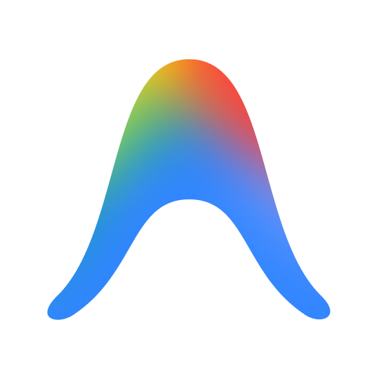
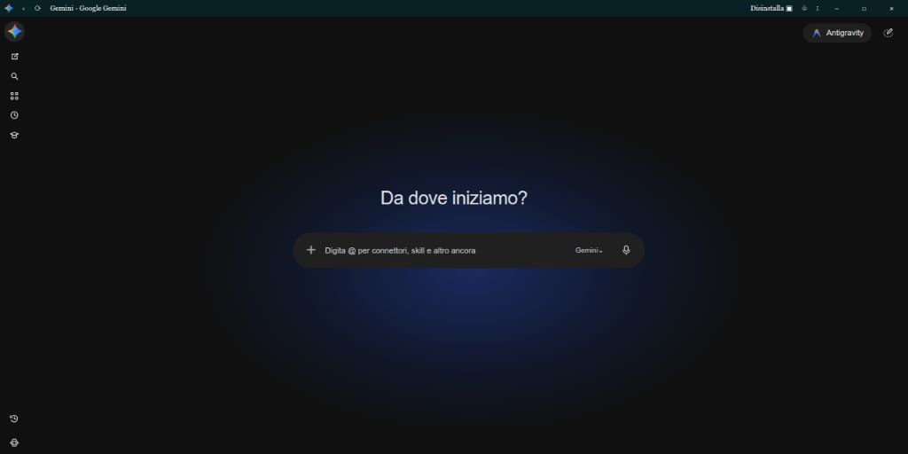
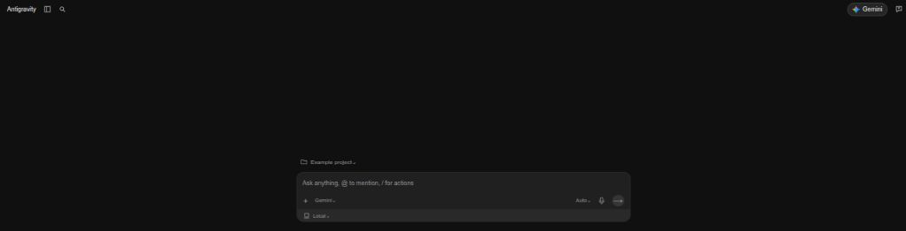
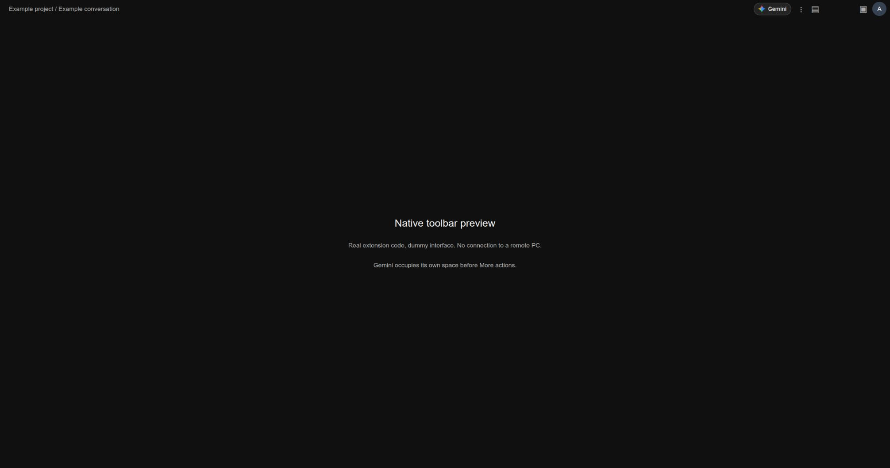

<p align="center">
  
</p>

# Gemini & Antigravity Bridge 🚀

[](https://developer.chrome.com/docs/extensions/mv3/intro/)
[](manifest.json)
[](LICENSE)

A sleek, lightweight Google Chrome extension (Manifest V3) that enables seamless, two-way switching between the **Google Gemini** web app (`gemini.google.com`) and your **Google Antigravity** session (`antigravity.google.com` or local/remote sessions).

Designed to blend in natively with Google's modern dark UI, it injects intuitive navigation shortcuts into both interfaces and removes visual clutter.
> [!TIP]
> 💡 **Idea & Inspiration**: Special shoutout to [@riccardo-vecchi](https://github.com/Riccardo-Vecchi) who inspired this solution.

> [!NOTE]
> **Disclaimer**: This project is an independent open-source tool and is not affiliated, associated, authorized, endorsed by, or in any way officially connected with Google LLC or Alphabet Inc. Google, Gemini, Chrome, and Antigravity are trademarks of Google LLC.

---

## 💡 Why This Extension? (The Windows Dilemma)

While macOS users enjoy Google Antigravity integrated directly into the native Gemini desktop application, **Windows currently lacks an official unified app** combining both environments.

This extension bridges that gap! By pairing this lightweight extension with Chrome's **Progressive Web App (PWA)** capabilities, Windows users get a seamless, dedicated desktop workspace in a single window without juggling cluttered browser tabs.

> ### 🖥️ Want a single screen to switch between Gemini and Antigravity without being in a browser?
>
> 1. **Install this extension** in Google Chrome (see [Installation](#-installation)).
> 2. **Set up Antigravity for background / remote session**:
>    - In Antigravity, connect to your **"Remote Session"**.
>    - 💡 **Pro-Tip (Hide the Antigravity window)**: A remote session requires Antigravity to be running on your machine. To keep your taskbar clean without seeing the Antigravity app window, go to **Settings** → **Application** → enable **"Keep In Menu Bar"** (System Tray). You can now close the main Antigravity window: it will stay running silently in the background tray so your session remains active!
> 3. **Copy the session link and save it in the extension settings** (Right-click extension icon → *Options* → paste URL and save).
> 4. **Install the Gemini PWA via Chrome**:
>    - Navigate to [gemini.google.com](https://gemini.google.com).
>    - Click the **Chrome menu (three vertical dots ⋮)** in the top-right corner.
>    - Select **Cast, save, and share** → **Install page as app...** (or *Install Gemini*).
>
> 🎉 **That's it!** Launch Gemini directly from your Windows Taskbar or Start menu as a standalone desktop app. Antigravity runs quietly in the system tray, while your Gemini PWA acts as a single, unified window for both Gemini and Antigravity!

---

## ✨ Features

- **Unified PWA / Desktop Experience**:
  - Turns the Gemini PWA into a complete dual-mode productivity hub on Windows.
- **Instant Switching between Gemini & Antigravity**:
  - **In Gemini**: Adds an *Antigravity* pill button in the top action bar right beside your user profile.
  - **In Antigravity**: Adds a sleek *Gemini* button anchored to the top action bar so there is zero overlap with existing controls:
    - **New Conversation Screen**: Positioned at the top-right side cleanly beside the native Feedback and Profile controls, creating perfect visual symmetry with the Gemini interface.
    - **Active Conversation Workspace**: Inserts the Gemini button into the native toolbar immediately before `⋮` More Actions, reserving its own space instead of overlaying controls. A measured fallback supports older/custom workspaces.
- **Tab & Window Control**:
  - **Normal Click**: Smooth in-place navigation within the standalone PWA window or tab.
  - `Ctrl + Click` / `Cmd + Click` or `Middle-Click`: Opens the target in a new background/active browser tab.
- **Custom Antigravity Endpoints**:
  - Easily point to your active remote session or local development server (`https://antigravity.google.com`, `http://localhost:*`, or `http://127.0.0.1:*`).
- **Clean UI & Clutter Removal**:
  - Automatically hides redundant header buttons (like the native *"Scarica l'app"* / *"Download app"* prompt in Gemini) for a distraction-free header.
- **Privacy & Lightweight**:
  - Pure Vanilla JavaScript, zero dependencies, zero tracking/telemetry.
  - Manifest V3 compliant with minimal permissions (`storage`).
    - Bundled official Google product icons; see [asset sources and checksums](ASSETS.md).
    - Workspace access is limited to `antigravity.static.usercontent.goog` rather than every `*.usercontent.goog` site. Cross-frame layout messages are checked against the expected iframe window and origin.
    - Toolbar updates follow DOM changes and resizing, without permanent 100/200 ms polling loops.

The saved endpoint must be an HTTPS Antigravity URL (including its subdomains), or an HTTP localhost/127.0.0.1 URL with an optional port. Invalid stored values are also rejected when opening a session. The extension does not start Antigravity or preserve unsaved drafts when navigating in the same tab. A PWA may show its browser-controlled address bar when leaving Gemini's scope.

---

## 📸 Screenshots

### 1. Injected Button in Google Gemini (PWA View)
Jump directly into Google Antigravity from the Gemini top bar:



---

### 2. Injected Navigation Pill in Google Antigravity (PWA View)
Return to Google Gemini with a single click from the Antigravity top header — anchored neatly to the side with zero overlap over any existing native buttons:



---

## 🛠️ Installation

### Developer Mode (Unpacked Extension)

1. **Clone or download this repository**:
   ```bash
   git clone https://github.com/FrancescoMin/gemini-antigravity-bridge.git
   ```
2. Open Google Chrome (or any Chromium-based browser).
3. Navigate to `chrome://extensions/` in the URL bar.
4. Enable **Developer mode** via the toggle switch in the top-right corner.
5. Click **Load unpacked** (*Carica estensione non pacchettizzata*).
6. Select the folder containing this project:
   ```text
   C:\path\to\gemini-antigravity-bridge
   ```

   > [!TIP]
   > **Folder Placement Recommendation**:
   > You do not have to place the project inside your user profile folder. Any permanent location on your drive works, provided that:
   > - **It is protected from accidental deletion**: avoid temporary locations or the Downloads folder, since Chrome loads unpacked extensions directly from their source path.
   > - **It does not require administrator privileges**: avoid system-protected directories (like C:\Program Files), which can cause file access issues and permission conflicts during edits or git updates.
7. The extension is now active.

---

## ⚙️ Configuration

To link your Antigravity remote session URL:

1. Right-click the extension icon in your Chrome toolbar and select **Options** (or go to `chrome://extensions` → Details → Extension options).
2. Enter your Antigravity session URL (e.g., your remote session URL, `https://antigravity.google.com`, or `http://localhost:8080`).
3. Click **Save**.

### 💡 Silent Background Operation (Hide Antigravity Window)

To keep your Antigravity remote session running without cluttering your taskbar with the open desktop window:
1. Open the Antigravity desktop application.
2. Go to **Settings** (`Ctrl+,`) → **Application**.
3. Enable **"Keep In Menu Bar"** (System Tray).
4. You can now close the main Antigravity window — it will stay alive in the background system tray, allowing the remote session and bridge extension to function uninterrupted.

---

## 📂 Project Structure

```text
gemini-antigravity-bridge/
├── assets/
│   └── screenshots/
│       ├── gemini-view.png          # Screenshot of Gemini PWA with Antigravity button
│       └── antigravity-view.png     # Screenshot of Antigravity PWA with Gemini button
├── content.js                       # Content script injecting the navigation buttons
├── styles.css                       # Styling for the injected UI elements
├── options.html                     # Options UI page
├── options.js                       # Storage handler for user preferences
├── antigravity-logo.png             # Antigravity button icon asset
├── gemini-logo.png                  # Official Gemini return-button icon
├── bridge-config.js                 # Shared endpoint validation
├── ASSETS.md                        # Official asset sources and checksums
├── manifest.json                    # Extension manifest (v3)
├── .gitignore                       # Git ignore definitions
├── LICENSE                          # Apache 2.0 License
└── README.md                        # Documentation
```

---

## ⚠️ Disclaimer

This project is an independent open-source tool and is not affiliated, associated, authorized, endorsed by, or in any way officially connected with Google LLC or Alphabet Inc.

Google, Gemini, Chrome, and Antigravity are trademarks of Google LLC. All brand and product names are used solely for identification and interoperability purposes.

## Development checks

```sh
npm ci --ignore-scripts
npm test
```

Node.js 22 and jsdom are used only for development tests; the installed extension has no npm runtime dependencies. Tests cover asset provenance, endpoint validation, toolbar reinsertion after SPA updates, cross-frame message checks, and modified/middle-click navigation. They do not establish that a live Google Remote Control session is connected. Reload the unpacked extension and its pages to test changes in a browser.

For a local layout preview with dummy data, serve this directory with `python3 -m http.server 8769 --bind 127.0.0.1`, then open `http://127.0.0.1:8769/test/preview.html`. The preview executes the real content script in both the shell and workspace frame.



---

## 📄 License

This project is licensed under the [Apache License 2.0](LICENSE).
